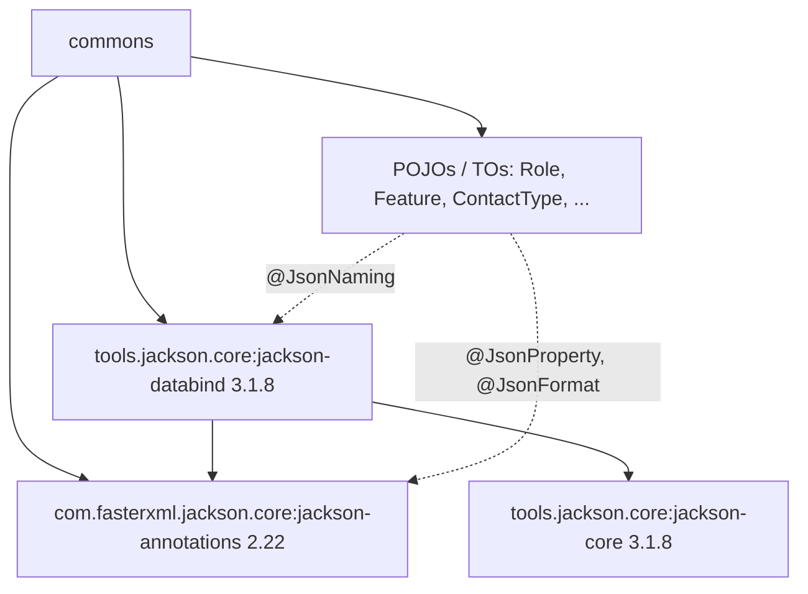
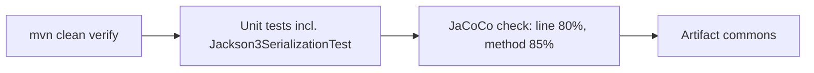

# Commons – Technical Guide: Jackson 3 migration

## Dependency layout

## Changes
- `pom.xml` / `bom/pom.xml`: `jackson-databind` and `jackson-core` moved to groupId `tools.jackson.core`;
  `jackson.databind.version` = `3.1.8`; the unused `jackson.version.core` property was removed.
- `@JsonNaming` imported from `tools.jackson.databind.annotation` in `ContactType`, `Feature`, `Role`, `SocialContact`,
  `Request`, `Response`.
- No `ObjectMapper` is used in main code, so no runtime API changes.

## Quality gates
- JaCoCo `verify`: bundle line coverage ≥ 80 %, **method coverage ≥ 85 %**, package branch coverage ≥ 80 %.
- `Jackson3SerializationTest` checks a JSON round-trip of `Role` with `tools.jackson`.

## Validation flow

